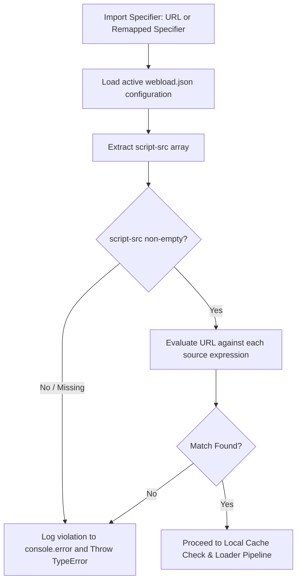

# Security Design: CSP-like `script-src` Allowlist

## 1. Overview & Policy Definition

The security model implements a Content Security Policy (CSP)-like allowlist mechanism defined in [`webload.json`](webload.json) under the top-level `"script-src"` key.

### Default Deny Rule
- If `"script-src"` is missing, `null`, or empty (`[]`), the allowlist is empty.
- An empty allowlist denies all external URL imports.
- Attempting to import any URL module when disallowed immediately logs a violation detail message to [`console.error()`](src/security.js:1) and throws a [`TypeError`](src/security.js:1) (standard exception for CSP/import violations).

### Import-Time Enforcement (Cache-Agnostic)
- Validation is enforced at **import resolution time** before checking local filesystem cache or initiating network requests.
- Even if a module is already present in `~/.cache/webload/` (e.g. downloaded under a different configuration), importing it under a configuration that disallows its origin will fail.

---

## 2. Source Expression Matching Rules

A source expression in `"script-src"` can take one of the following formats:

| Pattern Type | Example | Matches | Does NOT Match |
|---|---|---|---|
| **Scheme** | `"https:"` | `https://esm.sh/lodash`, `https://example.com/mod.js` | `http://esm.sh/lodash` |
| **Exact Host** | `"esm.sh"` or `"https://esm.sh"` | `https://esm.sh/mod.js` | `https://cdn.esm.sh/mod.js`, `http://esm.sh/mod.js` (if https specified) |
| **Wildcard Host** | `"*.esm.sh"` or `"https://*.esm.sh"` | `https://cdn.esm.sh/mod.js`, `https://sub.cdn.esm.sh/mod.js` | `https://esm.sh/mod.js` (unless `esm.sh` is also listed or wildcard rule allows root) |
| **Host + Port** | `"http://localhost:3000"` | `http://localhost:3000/app.js` | `http://localhost:8080/app.js` |
| **Path Prefix** | `"https://esm.sh/v135/"` | `https://esm.sh/v135/mod.js` | `https://esm.sh/v134/mod.js` |

---

## 3. Implementation Component Architecture

### `src/security.js`
- **Function `reportSecurityViolation(targetUrl, scriptSrcRules)`**:
  - Logs a formatted CSP violation message via [`console.error()`](src/security.js:1) providing full URL and active directive details.
  - Constructs and returns a [`TypeError`](src/security.js:1) with message: `Refused to load script from '<URL>' because it violates the following script-src directive: <rules>`.
- **Function `parseSourceExpression(expr)`**: Parses a single source string into a matcher descriptor (`scheme`, `host`, `wildcard`, `port`, `pathPrefix`).
- **Function `matchSourceExpression(parsedUrl, sourceRule)`**: Evaluates whether a target [`URL`](src/security.js:1) satisfies a single parsed rule.
- **Function `validateScriptSrc(targetUrl, scriptSrcRules)`**:
  - Validates `targetUrl` against `scriptSrcRules`.
  - If allowed: returns `true`.
  - If denied / unallowed: calls `reportSecurityViolation()` and throws the resulting [`TypeError`](src/security.js:1).

---

## 4. Integration Points

1. **Bun Plugin (`src/bun/plugin.js`)**:
   - In `onResolve` / `onLoad`, before returning cache paths or fetching, call [`validateScriptSrc(url, config.scriptSrc)`](src/security.js:1).
2. **Node.js Synchronous Hook (`src/node/hook.js` & worker)**:
   - In the resolver / fetch worker, validate the URL against `script-src` prior to cache check or worker dispatch.
3. **CLI Runners (`wicnode`, `wicbun`)**:
   - Pass the resolved configuration (`--config` or discovered `webload.json`) to the loaders.

---

## 5. Test Plan

1. **Missing / Empty `script-src`**:
   - Verify importing any `http://` or `https://` URL logs to `console.error` and throws [`TypeError`](src/security.js:1).
2. **Scheme Allowlist**:
   - Verify `"https:"` allows `https://...` and rejects `http://...`.
3. **Wildcard Host Allowlist**:
   - Verify `"*.esm.sh"` allows `https://cdn.esm.sh/mod.js` and `https://sub.esm.sh/mod.js`.
4. **Cache Isolation Test**:
   - Pre-populate cache with a module.
   - Run with a `webload.json` that does not allow the module's origin.
   - Verify the import fails at import resolution time despite being cached.
