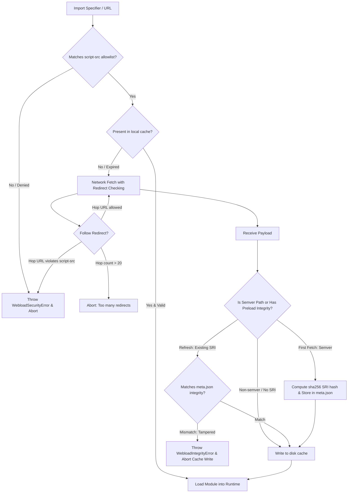

# WebLoad Security Architecture & Threat Model

WebLoad brings direct URL-based module loading and WICG Import Maps to Node.js and Bun. Loading executable JavaScript/TypeScript over HTTP/HTTPS introduces a distinct set of security considerations compared to traditional package management workflows.

This document outlines the threat model for URL-based imports, explains how WebLoad mitigates common attack vectors, details underlying assumptions, highlights open risks, provides best practices, and compares URL-based imports with traditional package-manager (e.g. npm) approaches.

---

## 1. URL-Based Import Security: Common Concerns & Threat Model

Loading remote modules at runtime presents specific security challenges:

1. **Remote Code Execution (RCE) from Untrusted Sources**:
   Allowing arbitrary URL imports could enable an attacker to execute malicious code simply by injecting or convincing an application to import a script from an arbitrary server.
2. **Man-In-The-Middle (MITM) & Network Interception**:
   Plaintext or compromised network transport could allow attackers to intercept, manipulate, or substitute module contents in transit.
3. **Content Mutation & CDN Compromise (Immutability Violation)**:
   Unlike local archives, remote URLs could serve different code over time. An upstream CDN compromise, rogue maintainer update, or dynamic server response could mutate code under an existing URL (e.g., modifying `pkg@1.2.3`).
4. **Malicious Redirections & Redirection Loops**:
   A seemingly trusted URL might issue HTTP 301/302/307/308 redirects to an untrusted domain, or initiate circular redirect loops causing Denial of Service (DoS).
5. **Cache Poisoning & Race Conditions**:
   Concurrent processes fetching or writing the same cached modules could result in corrupted, partial, or maliciously substituted files in the local cache.
6. **Supply Chain & Install-Time Vulnerabilities**:
   Third-party dependencies might contain hidden payloads or execute arbitrary scripts during setup or initialization.

---

## 2. How WebLoad Addresses URL Import Concerns

WebLoad implements multiple layers of defense-in-depth across resolution, network transport, caching, and execution:



### 2.1 Content Security Policy (CSP)-Like `script-src` Allowlist (Default Deny)

Implemented in [`src/security.js`](src/security.js:1):
- **Default Deny**: If `"script-src"` in [`webload.json`](webload.json) is missing, `null`, or empty (`[]`), all external network imports are denied by default.
- **Granular Rules**: Supports exact schemes (`"https:"`), exact hosts (`"https://esm.sh"`), wildcard subdomains (`"*.esm.sh"`), explicit ports (`"http://localhost:3000"`), and path prefixes (`"https://esm.sh/v135/"`).
- **Import-Time Enforcement**: Validation occurs at import resolution time before checking the local filesystem cache or initiating network requests. Even if a module exists in the local cache, it will be rejected if the active configuration denies its origin.
- **Standardized Exceptions**: Violations log detailed diagnostics to [`console.error()`](src/security.js:96) and throw [`WebloadSecurityError`](src/security.js:67) (a subclass of [`TypeError`](src/security.js:67)).

### 2.2 Strict Redirection Verification & Loop Prevention

Implemented in [`src/node/sync-fetch-worker.js`](src/node/sync-fetch-worker.js:1) and [`src/bun/plugin.js`](src/bun/plugin.js:1):
- **Per-Hop Validation**: Every intermediate HTTP redirect destination is validated against the active `"script-src"` allowlist before the request is dispatched.
- **Cross-Origin Redirection Guard**: If a trusted origin redirects to an unauthorized origin (e.g. `https://trusted.com/mod.js` $\rightarrow$ `https://evil.com/payload.js`), the request is immediately aborted with a [`WebloadSecurityError`](src/security.js:67).
- **Loop Protection**: Multi-hop redirects are capped at 20 hops to prevent infinite redirect loops and resource exhaustion attacks.

### 2.3 Trust-On-First-Use (TOFU) Subresource Integrity (SRI)

Implemented in [`src/security.js`](src/security.js:1) and [`src/cache.js`](src/cache.js:1):
- **Semver Path Detection**: URLs matching semantic version patterns (`\d+\.\d+\.\d+`, e.g., `lodash@4.17.21`, `/v1.2.3/index.js`, `package-2.0.1.mjs`) automatically trigger TOFU integrity locking.
- **Cryptographic Hash Generation**: On the first download, WebLoad computes a standard W3C Subresource Integrity (SRI) hash (`sha256-<base64>`) using [`computeIntegrityHash()`](src/security.js:42) and stores it in the module's `.meta.json` file.
- **Refresh Verification**: When a cached module expires and re-fetches from the remote endpoint, WebLoad validates the incoming payload against the stored `integrity` hash using [`verifyIntegrity()`](src/security.js:54).
- **Tampering Rejection**: If remote content has mutated or been altered, WebLoad throws [`WebloadIntegrityError`](src/security.js:12), discards temporary downloads, and keeps the original cached version intact.

### 2.4 Preloading & Explicit SRI Hash Pinning

Implemented in [`bin/wicutil`](bin/wicutil:1):
- **Ahead-Of-Time Verification**: Developers and CI/CD pipelines can pre-populate and lock the cache using `wicutil --preload <URL> --integrity <hash>`.
- **Non-Semver URL Pinning**: Supplying `--integrity` allows pinning exact cryptographic hashes for non-semver URLs as well as semver URLs.
- **Zero-Network Air-Gapped Execution**: Preloading enables production containers to execute without runtime internet access.

### 2.5 Atomic Disk Cache & Metadata-First Commits

Implemented in [`src/cache.js`](src/cache.js:1):
- **Atomic Operations**: New files are written to unique temporary paths (`.tmp.<uuid>.js` and `.tmp.<uuid>.meta.json`) before being atomically renamed into place.
- **Metadata-First Ordering**: The `.meta.json` file containing integrity and expiration information is committed before the primary code file, preventing race conditions where unverified code could be executed.
- **Cache-Control Adherence**: WebLoad honors HTTP `Cache-Control` response directives (`max-age`, `no-cache`, `no-store`, `private`, and `must-revalidate`).

---

## 3. Assumptions

WebLoad's security model operates under the following explicit assumptions:

1. **Transport Security (TLS / HTTPS)**:
   It is assumed that public remote modules are served over HTTPS and that the underlying runtime (Node.js/Bun) correctly verifies TLS certificates and prevents network eavesdropping/spoofing.
2. **First-Use Authenticity (TOFU)**:
   Unless explicit hashes are provided via `wicutil --preload --integrity`, WebLoad assumes that the module received on the *very first download* is authentic. Subsequent downloads are verified against this initial baseline.
3. **Local Cache Boundary & Filesystem Integrity**:
   WebLoad assumes standard OS user-level permission boundaries. The local cache directory (`~/.cache/webload` or configured `cacheDir`) is assumed protected from unauthorized local user modification.
4. **Configuration Authority**:
   The [`webload.json`](webload.json) configuration file is assumed to be authored and maintained by the project owner and committed to trusted version control.
5. **Semver Semantic Immutability**:
   WebLoad assumes that URLs containing semver patterns represent immutable release artifacts that should never change content under the same version tag.

---

## 4. Known Open Risks & Limitations

While WebLoad significantly hardens URL module loading, developers should be aware of remaining operational risks:

1. **First-Download Compromise**:
   Under pure TOFU (without `--preload --integrity`), if an attacker compromises the upstream CDN *before* your first fetch, the malicious payload's hash will be recorded as the trusted baseline.
2. **Unpinned Non-Semver URLs**:
   URLs without semver strings (e.g. `https://example.com/latest.js` or `https://esm.sh/lodash`) do not receive automatic TOFU locking unless explicitly preloaded with `--integrity`.
3. **Dynamic Transitive Imports**:
   If a remote module imports another remote URL dynamically or uses unversioned transitive dependencies, those secondary URLs must also be covered by your `"script-src"` rules.
4. **Runtime Execution Privileges**:
   Like any JavaScript module loaded into Node.js or Bun, once validated and executed, a module runs with the full system privileges of the host process (file access, network sockets, environment variables). WebLoad is a module loader and integrity verifier, not an OS sandbox.
5. **Cache Eviction Reset**:
   Explicitly removing a cached entry via `wicutil --remove <URL>` deletes both the content and `.meta.json`. The subsequent fetch will record a new TOFU hash rather than checking against the previously deleted hash.

---

## 5. Security Best Practices

To achieve the highest level of security with WebLoad in development and production:

### 1. Restrict `script-src` to Specific Origins and Path Prefixes
Avoid overly broad rules like `"https:"`. Specify exact trusted domains or path prefixes:
```json
{
  "script-src": [
    "https://esm.sh/lodash-es@4.17.21/",
    "https://cdn.jsdelivr.net/npm/"
  ]
}
```

### 2. Always Use Exact Semver URLs or Import Map Remapping
Always include full semantic version tags in your import URLs so WebLoad automatically enforces TOFU integrity checks:
```json
{
  "imports": {
    "canvas-confetti": "https://esm.sh/canvas-confetti@1.9.4"
  }
}
```

### 3. Preload and Pin Hashes in CI/CD Build Pipelines
In security-sensitive environments, preload modules with explicit integrity hashes during container or artifact build steps:
```bash
wicutil --preload https://esm.sh/lodash-es@4.17.21 --integrity sha256-47DEQpj8HBSa+/TImW+5JCeuQeRkm5NMpJWZG3hSuFU=
```

### 4. Commit `webload.json` to Version Control
Treat [`webload.json`](webload.json) as a security configuration artifact. Review changes to `"script-src"`, `"imports"`, and `"scopes"` during code reviews.

### 5. Run Production in Air-Gapped / Pre-Cached Mode
For production deployments, pre-warm the cache directory in CI, mount or package the cache with the application, and restrict outbound internet access from production nodes.

---

## 6. Comparison: URL-Based Imports vs. Packaging (e.g. npm)

| Security Aspect | URL-Based Imports (WebLoad) | Package Manager (e.g. npm / pnpm / yarn) |
|---|---|---|
| **Install-Time Code Execution** | **Zero install scripts**. WebLoad does not execute arbitrary `preinstall` or `postinstall` lifecycle scripts during dependency setup. | **High Risk**. Packages can run arbitrary shell scripts during `npm install` (`postinstall` hooks are a primary vector for credential theft). |
| **Origin / Distribution Control** | Explicit origin allowlist via `"script-src"`. Direct HTTP/HTTPS fetches from authorized CDNs or internal servers. | Centralized or private registries (e.g., `registry.npmjs.org`). Requires registry credentials and `.npmrc` scoping. |
| **Integrity Verification** | Automatic TOFU Subresource Integrity for semver URLs + explicit SRI pinning with `wicutil --preload --integrity`. | Cryptographic SHA-512 hashes recorded in `package-lock.json` or `pnpm-lock.yaml`. |
| **Attack Surface & Typosquatting** | Reduced package-name typosquatting; imports target explicit domains/paths. Vulnerable to DNS hijacking or CDN server compromise. | High typosquatting risk on public registries; account takeovers on public package names. |
| **Filesystem Footprint** | Flat, deduplicated, atomic content cache in `~/.cache/webload`. No deeply nested `node_modules` trees. | Large, nested or symlinked `node_modules` directories per project. |
| **Transitive Dependency Drift** | Resolved via CDN or standard ES module graph imports. Transitive dependencies must satisfy `"script-src"`. | Resolved via lockfile resolution tree. Lockfiles pin entire transitive dependency trees. |
| **Offline & Air-Gapped Operation** | Supported via local cache or `wicutil --preload`. | Supported via offline cache, `.tgz` tarballs, or vendored `node_modules`. |
| **Update Velocity & Immutability** | Instant access to newly published versions; semver paths protected by TOFU. | Requires explicit `npm update` or `package.json` bump and lockfile regeneration. |

### Summary of Trade-offs

- **Where WebLoad Excels**:
  - Eliminates dangerous package install scripts (`postinstall` malware).
  - Enforces explicit domain and origin allowlists (`"script-src"`).
  - Eliminates local `node_modules` bloat and complex packaging steps for lightweight, web-first, and serverless applications.
  - Standardizes module resolution across browsers, Node.js, and Bun.

- **Where Traditional Packaging Excels**:
  - Full-tree lockfiles capture every nested transitive dependency hash upfront.
  - Broad ecosystem tooling for vulnerability scanning (e.g., `npm audit`, Snyk, Dependabot).
  - Established private registry workflows for proprietary enterprise code distribution.
