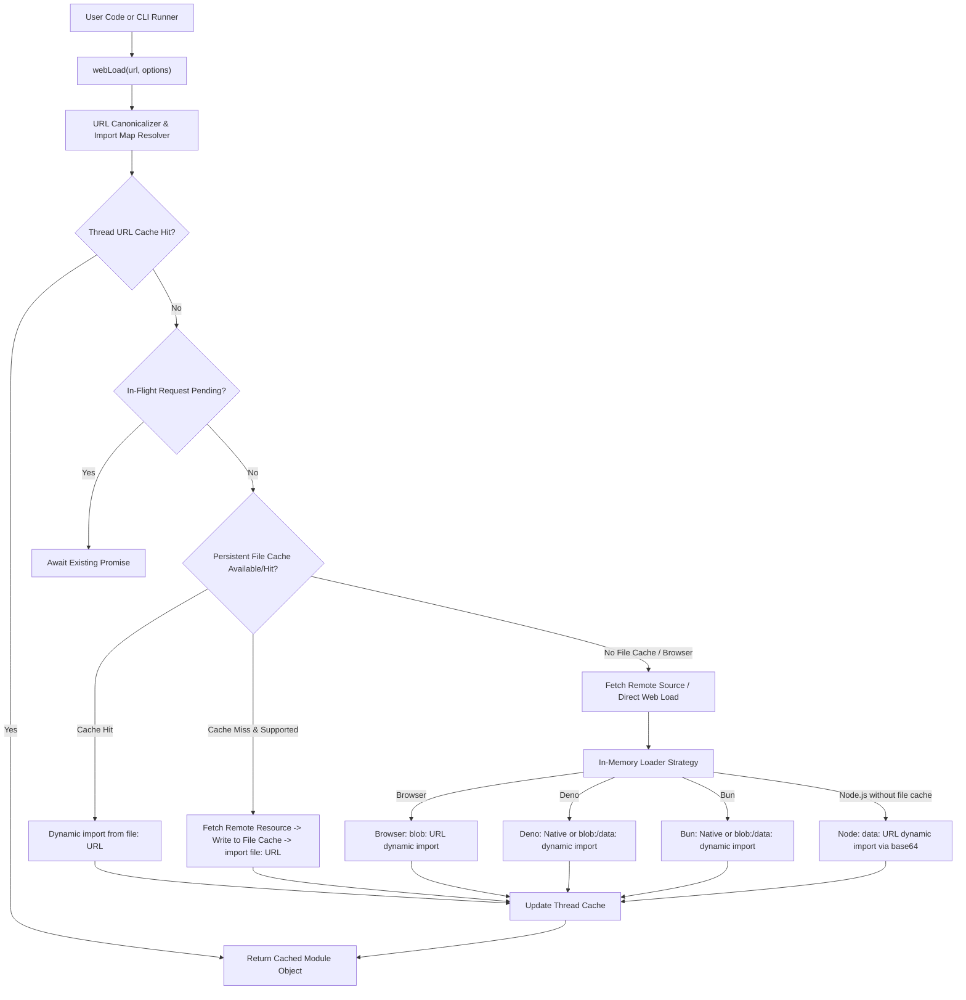

# System Patterns: WebLoad Architecture

## High-Level Architecture

WebLoad coordinates runtime environment detection, URL canonicalization, import map resolution, and multi-tier caching to deliver unified module loading across platforms.

## Key Architectural Patterns & Components

### 1. Adapter Strategy Pattern
- **File Cache Loading (Server Runtimes)**: On platforms with filesystem access (Node, Deno, Bun) where file caching is active, modules are fetched, written to cache, and imported directly via standard `file://` URLs. This cleanly bypasses `data:` URL length limitations and runtime-specific HTTP dynamic import restrictions.
- **[`BrowserAdapter`](src/adapters/browser.js:1)**: Leverages native browser dynamic [`import()`](src/adapters/browser.js:1) or constructs object URLs using [`URL.createObjectURL()`](src/adapters/browser.js:1) backed by blobs. Integrates with `<script type="importmap">`.
- **[`DenoAdapter`](src/adapters/deno.js:1)**: Leverages native HTTPS URL dynamic [`import()`](src/adapters/deno.js:1) and `blob:` / `data:` URL imports.
- **[`BunAdapter`](src/adapters/bun.js:1)**: Leverages native dynamic imports, `data:` URLs, and internal blob registry URLs.
- **[`NodeAdapter`](src/adapters/node.js:1)**: Avoids deprecated [`module.register()`](src/adapters/node.js:1) and unsupported `blob:` URLs (`ERR_UNSUPPORTED_ESM_URL_SCHEME`). When file caching is disabled, uses UTF-8 safe `data:` URL dynamic imports (`data:text/javascript;base64,...`).

### 2. URL Canonicalization & Import Map Resolution
- Maps bare or mapped specifiers through standard import map configurations (`<script type="importmap">` in browsers, JSON import maps in CLI/server runtimes).
- Resolves relative URLs to absolute URLs using caller-provided import metadata (`import.meta.url`).

### 3. Concurrency & Caching Subsystem
- **Thread URL Cache**: A per-thread Map mapping canonical URLs to resolved module namespaces, guaranteeing referential identity for duplicate imports of the same URL.
- **In-Flight Request Deduplication**: A registry of active loading Promises preventing duplicate concurrent network requests for identical URLs.
- **Persistent File Cache**: Filesystem cache on supported server platforms (Node, Deno, Bun) storing downloaded module sources, enabling fast restarts, offline support, and `file://` URL importing.

### 4. Binary & Base64 Encoding Subsystem
- Adheres to modern TC39 specifications using [`Uint8Array.prototype.toBase64()`](src/utils/encoding.js:1) when available.
- Provides a UTF-8 safe fallback encoder to process Unicode UTF-16 code points reliably without using [`btoa()`](src/utils/encoding.js:1).

### 5. CLI Architecture
- **Unified Single-File Dispatcher**: A single executable script handling `webload`, `bwebload`, `dwebload`, and `nwebload` (via symlinks or wrapper invocations), selecting default runtime based on invoked command name (`argv[0]`) or explicit runtime flags (`-b`, `-d`, `-n`).
- Explicit runtime selection overrides a default selection, but conflicting runtime selection is an error.
- **Cache Management**: Command-line flag `--clear` to purge persistent module cache files. May be used alone or in conjunction with execution mode (clearing before execution).
