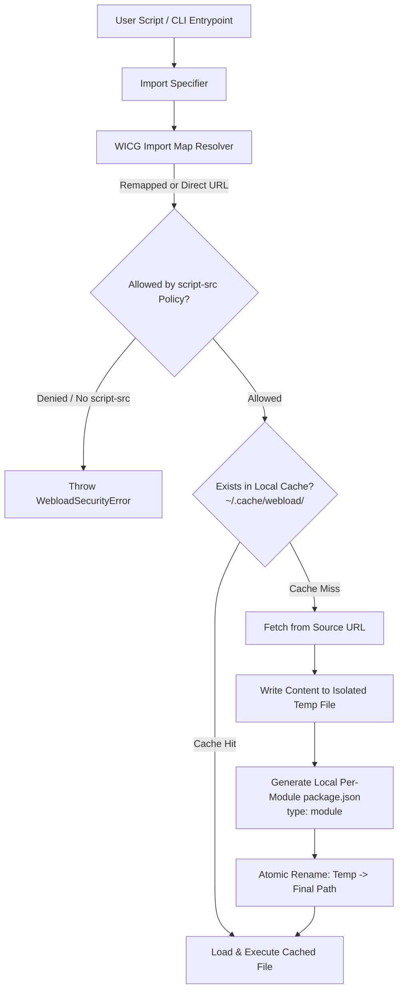

# System Patterns: WebLoad Architecture

## High-Level Architecture & Unified Loading Pipeline

WebLoad (WIC) provides a unified module loading model across **Node.js** and **Bun** backed by a shared, atomic filesystem cache.

---

## Key Architectural Patterns & Components

### 1. Unified Operation Model
Both Node.js and Bun loaders follow the exact same lifecycle:
1. **Specifier Resolution**: Remap specifier using WICG Import Maps (`imports` and `scopes`).
2. **Import-Time Security Validation (`script-src`)**:
   - Check target URL against active `script-src` rules before cache lookup or loading.
   - If `script-src` is missing, empty, or fails matching, immediately throw [`WebloadSecurityError`](src/security.js:1).
   - Guarantees cached files cannot be imported if the current workspace policy denies that host/scheme.
3. **Cache Lookup**: Check if the sanitized URL path exists in `~/.cache/webload/`.
4. **On Cache Miss (Fetch & Atomic Write)**:
   - Synchronously (Node) or asynchronously (Bun) fetch the module source from the network.
   - Write to an isolated temporary file in the cache directory.
   - Generate auxiliary per-module metadata ([`package.json`](package.json) with `{"type": "module"}`).
   - Atomically rename the temporary file to its final destination path (`temp -> rename`).
5. **Module Loading**: Directly load and execute the verified on-disk file from the local cache.

---

### 2. Node.js Synchronous Import Hook Pattern
- **Synchronous Resolution Model**:
  - Node.js ESM import resolution can require synchronous resolution and fetching.
  - Implements the pattern demonstrated by `unjs/env-runner` (e.g. using [`worker_threads`](memory-bank/techContext.md) synchronized via [`Atomics.wait()`](memory-bank/techContext.md) and [`SharedArrayBuffer`](memory-bank/techContext.md), synchronous subprocess fetching, or synchronous HTTP primitives).
  - Guarantees synchronous imports in Node resolve reliably without blocking the main event loop or timing out.
- **Strict Deprecation Avoidance**:
  - Does NOT use deprecated or removed Node loader customization APIs (specifically avoiding [`module.register()`](memory-bank/techContext.md)).

---

### 3. Bun Plugin Architecture
- **Hooking Mechanism**:
  - Implemented as a native Bun plugin via [`Bun.plugin({ setup(build) { ... } })`](memory-bank/techContext.md).
  - Registers `onResolve` / `onLoad` matchers with regular expression filters matching URL protocols (`filter: /^https?:\/\//`).
  - Intercepts both static [`import`](memory-bank/techContext.md) statements and dynamic [`import()`](memory-bank/techContext.md) calls.
- **Preload Integration**:
  - Automatically preloaded using Bun's `-r` / `--preload` flag, eliminating configuration requirements for user scripts.

---

### 4. Filesystem Cache Structure & Concurrency Strategy
- **Default Cache Location**: `~/.cache/webload/`.
- **Atomic Operations**:
  - All file downloads are written to temporary files and atomically renamed via filesystem rename operations.
  - Guarantees concurrent processes never observe or execute partially downloaded module files.
- **Per-Module Auxiliary Files**:
  - Node.js requires an enclosing [`package.json`](package.json) with `{"type": "module"}` to treat `.js` files as ES Modules.
  - Auxiliary [`package.json`](package.json) files are generated on a **per-module or per-module-directory basis** inside the module's isolated cache folder.
  - **Shared root `package.json` modification is prohibited**, eliminating cross-process file-locking bottlenecks and filesystem race conditions.
- **URL Path Sanitization & Relative Import Preservation**:
  - Deterministically escapes filesystem-reserved characters (`:`, `*`, `?`, `"`, `<`, `>`, `|`), query strings, and port numbers.
  - Preserves hierarchical directory structures so relative imports (e.g. `import "./sub.js"`) inside remote modules resolve naturally to adjacent files in the cache.

---

### 5. Security & `script-src` Allowlist Subsystem
- **Policy Enforcement Engine**:
  - Validates URLs against an array of source expressions defined under `"script-src"` in [`webload.json`](webload.json).
  - Empty or absent `"script-src"` acts as an empty allowlist (default deny).
  - Evaluated on every URL module import at resolution time (agnostic of cache state).
- **Matching Rules**:
  - Scheme: Matches URLs with matching protocol (e.g. `https:`, `http:`).
  - Host & Ports: Matches specific hosts/ports (e.g. `esm.sh`, `localhost:3000`).
  - Wildcard Subdomains: Matches `*.domain.tld` or `https://*.domain.tld` against any subdomain hierarchy.
  - Path Prefixes: Matches URL pathname prefixes when specified.

---

### 6. Import Map & Configuration Subsystem
- **WICG Specification Conformance**:
  - Full compliance with the WICG Import Maps specification, supporting top-level `"imports"` and context-specific `"scopes"`.
  - Resolves bare specifiers and path prefixes before security validation or network operations.
- **Configuration Discovery Hierarchy**:
  1. CLI argument override: `--config <path>` or `--import-map <path>`
  2. Local directory configuration: `./webload.json`
  3. User home configuration: `~/webload.json`

---

### 7. Command-Line Tools Suite
- **`wicbun`**:
  - Automatically preloads the WebLoad Bun plugin.
  - Executes local file paths or remote URL main entrypoints (e.g., `wicbun https://example.com/mod.js`).
- **`wicnode`**:
  - Automatically preloads the WebLoad synchronous Node hooks.
  - Executes local file paths or remote URL main entrypoints (e.g., `wicnode https://example.com/mod.js`).
- **`wicutil`**:
  - `wicutil --clear`: Purges the local cache directory.
  - `wicutil --list`: Lists all cached modules by URL and local path.
  - `wicutil --remove <URL...>`: Selectively evicts specific cached modules by URL.
