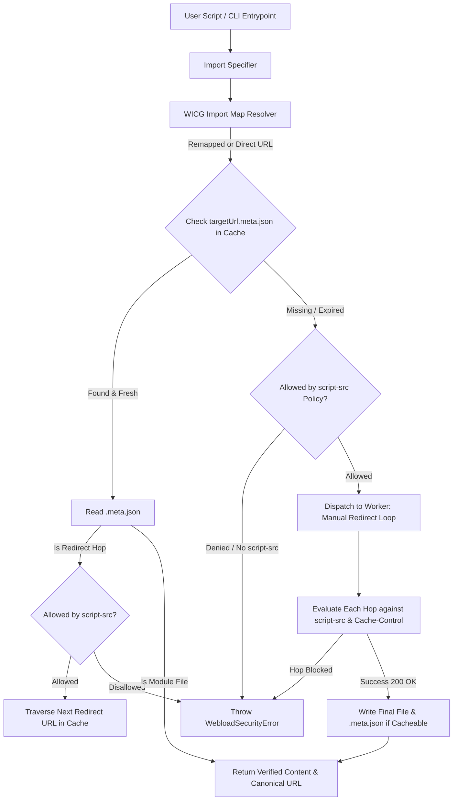

# System Patterns: WebLoad Architecture

## High-Level Architecture & Unified Loading Pipeline

WebLoad (WIC) provides a unified module loading model across **Node.js** and **Bun** backed by a shared, atomic filesystem cache with metadata-first inspection, stepwise redirect persistence, and CSP enforcement.

---

## Key Architectural Patterns & Components

### 1. Unified Operation Model
Both Node.js and Bun loaders follow the exact same lifecycle:
1. **Specifier Resolution**: Remap specifier using WICG Import Maps (`imports` and `scopes`).
2. **Metadata-First Cache Inspection**:
   - Inspect `.meta.json` before reading primary content files.
   - Respect RFC 9111 `Cache-Control` max-age expiration (`expiresAt` timestamp check).
   - Support redirect-only cache records (e.g. 301/308 responses without executable JavaScript bodies) for zero-network offline redirect resolution.
3. **Stepwise Per-Hop Security Validation (`script-src`)**:
   - Evaluate initial URL and every intermediate/final redirect hop URL against active `script-src` allowlist rules.
   - Throw [`WebloadSecurityError`](src/security.js:5) immediately if any hop fails matching.
4. **Canonical URL Base Tracking**:
   - Maintain in-memory `canonicalUrlMap` (`initialUrl -> finalUrl`) so relative sub-imports (`./utils.js`) within redirected modules resolve against the final canonical URL.
5. **Worker Thread Fetch & Abort Architecture (Approaches 1 + 4)**:
   - Worker implements manual redirect loop (`redirect: 'manual'`) and socket-level abort via [`AbortSignal.timeout()`](src/node/sync-fetch-worker.js).
   - Main thread waits with $+500\text{ms}$ IPC grace period via [`Atomics.wait()`](src/node/sync-fetch.js) and recycles deadlocked workers via `worker.terminate()`.

---

### 2. Node.js Synchronous Import Hook Pattern
- **Synchronous Resolution Model**:
  - Node.js ESM import resolution requires synchronous resolution and fetching.
  - Background worker thread communicates with main thread via [`SharedArrayBuffer`](src/node/sync-fetch.js) and [`Atomics.wait()`](src/node/sync-fetch.js).
- **CRITICAL TESTING RULE: Isolated Test Servers**:
  - Because `fetchSync()` synchronously blocks the main thread's event loop via `Atomics.wait()`, any in-process HTTP test server on the main thread will stall.
  - All mock HTTP servers in tests **MUST** be run in a dedicated `Worker` thread (`new Worker(workerCode, { eval: true })`).

---

### 3. Bun Plugin Architecture
- Native Bun plugin via `Bun.plugin({ setup(build) { ... } })`.
- Registers `onResolve` / `onLoad` matchers with `canonicalUrlMap` resolution for relative specifiers and redirect hops.

---

### 4. Filesystem Cache Structure & Concurrency Strategy
- **Default Cache Location**: `~/.cache/webload/`.
- **Atomic Operations**: Atomic write to temporary file followed by rename (`temp -> rename`).
- **Metadata-First Schema**: Every cached resource has a corresponding `.meta.json` containing URL, HTTP status, redirect location (if applicable), Content-Type, and `expiresAt` expiration.
- **Uncacheable Handling**: Modules returning `Cache-Control: no-store`, `no-cache`, `private`, or `must-revalidate` bypass disk persistence and are executed only in-memory for the current process.
